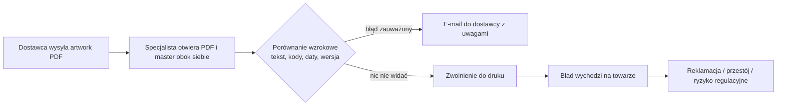
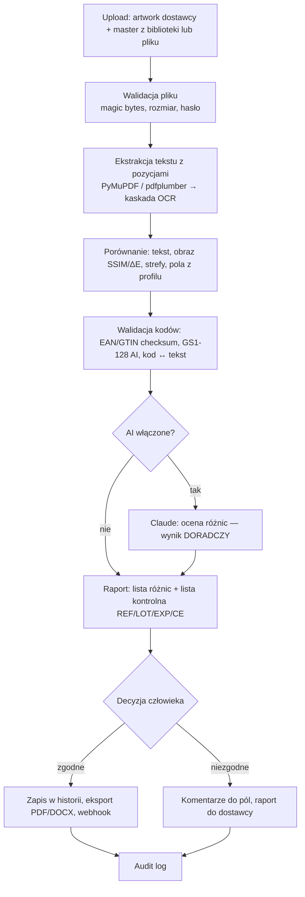
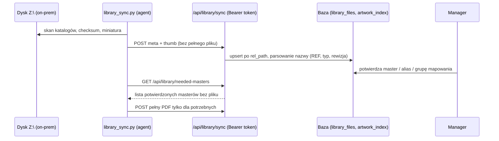

# Procesy — AS-IS i TO-BE

## 1. Kontrola artworku dostawcy

### AS-IS (ręcznie, przed narzędziem)

Problemy: brak powtarzalności, brak śladu decyzji, kody kreskowe sprawdzane „na oko", zmęczenie uwagi
przy 31 tys. masterów i wielu rewizjach.

### TO-BE (z aplikacją)

## 2. Utrzymanie biblioteki masterów

## 3. Render 3D i push do PalViz

Dieline PDF → wykrycie paneli (crease lines / szablon wykrojnika) → tekstury → GLB (trimesh) → podgląd
`<model-viewer>` → akceptacja układu przez użytkownika → rejestr renderów → push (Bearer, Idempotency-Key)
do PalViz w wątku tła; bez `PALVIZ_PUSH_URL` push jest wyłączony.

## 4. Proces wytwórczy (zespół BA/DEV/SEC)

Opisany w `CONTRIBUTING.md` (kroki 1–7, Definition of Ready/Done). Ślad: issue → gałąź `feature/<id>` →
PR z checklistami → przegląd SEC → odbiór BA → akceptacja PO → merge → CHANGELOG.
