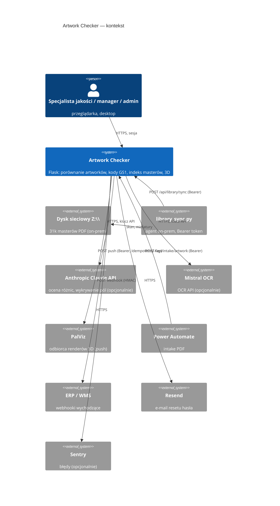

# Architektura (C4: kontekst i kontenery)

> [DEV] Stan na 2026-10-15. Dawny `docs/architektura.md` opisywał **system-matkę DocCompare** — przeniesiony do
> `docs/archiwum/architektura_doccompare.md` (US-016). Szczegóły modułów: `CLAUDE.md` → „Architecture".

## Kontekst (C4 L1)



## Kontenery (C4 L2)

```mermaid
flowchart TB
    subgraph host[Host: Docker / Coolify lub Render, UE]
        web[gunicorn 2×3 wątki<br/>app.py + blueprints/ + core/]
        worker[worker.py (RQ) — opcjonalnie<br/>fallback: wątki w web]
        db[(PostgreSQL prod / SQLite dev<br/>db.py — translacja dialektów)]
        fs[(Wolumen /data<br/>uploads, artwork_masters, artwork3d, glb_cache, SQLite)]
        redis[(Redis — opcjonalnie)]
    end
    browser[Przeglądarka<br/>Jinja2 + Alpine.js + Tailwind<br/>pdf.js, model-viewer, Chart.js]
    browser -->|HTTPS| web
    web --> db
    web --> fs
    web -.enqueue.-> redis
    redis -.-> worker
    worker --> db
    worker --> fs
```

## Komponenty wewnątrz `web`

| Warstwa | Moduły | Uwagi |
|---|---|---|
| Trasy | `app.py` (272), `blueprints/{palviz,users}.py` (słowniki DocCompare usunięte w US-010) | kierunek: blueprint → core/db, nigdy → app |
| Bezpieczeństwo | `core/security.py` (role, `login_required`, `require_role`, CSRF), `core/audit.py` | |
| Domena artwork | `artwork_comparator.py`, `artwork_zone_comparator.py`, `artwork_report_engine.py`, `artwork_batch_processor.py`, `barcode_validator.py`, `artwork_text_layer.py` | ML/OCR importowane leniwie |
| Biblioteka | `artwork_index.py`, `artwork_naming.py`, `artwork_manage.py`, `artwork_card.py`, `artwork_marm_link.py`, `library_sync.py` (agent) | |
| 3D | `artwork_3d.py`, `dieline_templates.py`, `artwork_palviz.py`, `artwork_render_registry.py`, `palviz_push.py` | trimesh, shapely |
| Master data | `material_master.py`, `material_uom.py`, `uom.py`, `supplier_master.py`, `supplier_profiles.py` | |
| AI | `ai_validator.py`, `ai_learning.py`, `api_usage_tracker.py` | budżet, rate limit |
| Ekstrakcja | `pdf_extractor.py`, `table_extractor.py`, `normalizer.py`, `yolo_detector.py` | kaskada |
| Infra | `db.py`, `migrate_db.py`, `constants.py`, `jobs.py`, `worker.py`, `translations.py`, `translation_en.py`, `export_engine.py` | |

## Przepływ żądania „porównaj"

1. `POST /api/artwork/compare` → `login_required` + `csrf_protect` → limit 30/min (DB) → walidacja plików
   (rozszerzenie, magic bytes) → zapis do `UPLOAD_FOLDER` z prefiksem `uid_`.
2. `_HEAVY_SEM` (3 równoległe) → `artwork_comparator.compare_artworks()` → wynik w `_artwork_cache`
   (pamięć procesu, właściciel = uid) i `comparisons` (DB) przez `_save_comparison`.
3. Front odpytuje `/api/artwork/page/<cache_id>/<n>` (kontrola właściciela) i renderuje raport.
4. Pliki tymczasowe usuwane w `finally`; audit log `artwork_compare`.

## Decyzje architektoniczne

- ADR-0001 — monolit Flask bez przepisywania; rozbijanie na blueprinty przyrostowo.
- ADR-0002 — narzędzia jakości i bezpieczeństwa w CI (co blokuje, co doradcze).
- ADR-0003 — jedna warstwa DB dla SQLite i PostgreSQL przez translację SQL.
- ADR-0004 — etapowa migracja do ścisłej CSP (report-only → bez CDN/Babel → Alpine CSP → nonce → egzekwowanie). Etapy 3–4 (US-023): akcje `data-on-*` przez `static/js/csp_actions.js`, egzekwowany nonce; etap 2b (US-024): Alpine w buildzie CSP — polityka bez `'unsafe-inline'` i `'unsafe-eval'`.
- Frontend (US-022): biblioteki JS w przypiętych wersjach w `static/vendor`, Tailwind i JSX raportu budowane
  `npm run build` (`tools/build_frontend.mjs`, `package.json`); zbudowane pliki są w repo, job CI `frontend` sprawdza zgodność.

## Znane ograniczenia

- Stan w pamięci procesu (`_artwork_cache`, `_login_attempts`) nie jest dzielony między workerami.
- Schemat DB tworzony w 10 plikach (`CREATE TABLE IF NOT EXISTS`) — brak wersjonowanych migracji.
- Ciężkie zadania w wątkach procesu web (timeout 300 s) — plan: RQ (`docs/KOLEJKOWANIE.md`).
