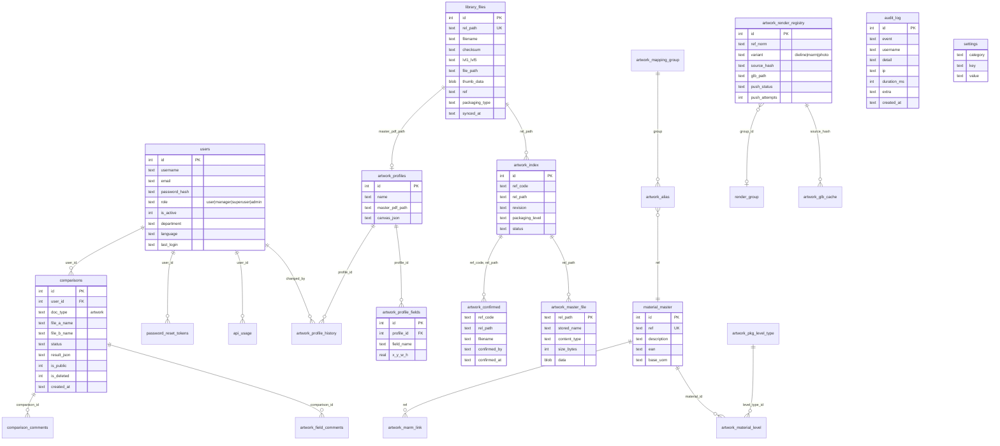

# Model danych

> [DEV] ERD obejmuje tabele rdzenia artworkowego. Pełna lista 64 tabel z plikiem definiującym — na końcu.
> Schemat powstaje przez `migrate_db.py` (idempotentnie, przy starcie kontenera) oraz `CREATE TABLE IF NOT EXISTS`
> w modułach domenowych. Klucze obce są w większości **logiczne** (bez constraintów) — dziedzictwo SQLite.

## Tabele operacyjne

| Tabela | Rola | Dane wrażliwe |
|---|---|---|
| `users` | konta i role | dane osobowe, hash hasła |
| `password_reset_tokens` | tokeny resetu (jawne — US-003) | poufne |
| `settings` | konfiguracja (token sync, klucz AI — US-004, e-mail) | poufne |
| `audit_log` | ślad działań | dane osobowe (nazwa, IP) |
| `api_usage`, `api_rate_events` | koszty i limity wywołań | per użytkownik |
| `async_jobs`, `artwork_batch_jobs` | zadania w tle | — |
| `intake_queue`, `webhooks` | integracje | sekrety webhooków |
| `artwork_glb_cache`, `render_group`, `dieline_templates` | 3D | — |

## Wszystkie tabele i miejsce definicji (po US-028)

`migrate_db.py`: api_usage, artwork_batch_jobs, artwork_glb_cache, artwork_mapping_group, artwork_marm_link,
artwork_master_file, artwork_profile_fields, artwork_profiles, artwork_render_registry, comparison_comments,
comparisons, intake_queue, library_files, ref_database, render_group, schema_migrations, settings,
supplier_audit_log, suppliers, users.
`app.py`: api_rate_events, artwork_field_comments, artwork_field_dict, artwork_field_feedback, artwork_material,
artwork_material_level, artwork_pkg_level_type, artwork_profile_history, async_jobs, audit_log, notifications,
password_reset_tokens, products, webhooks.
`artwork_index.py`: artwork_alias, artwork_confirmed, artwork_index. `artwork_manage.py`: artwork_file_status.
`material_master.py`: material_master. `blueprints/palviz.py`: dieline_templates.

**Relikty DocCompare usunięte w US-028** (decyzja PO 2026-10-17: „usuń”): kod nie tworzy już 25 tabel
(`tools/drop_relic_tables.py` → `RELIC_TABLES`: kolejka_*, zlecenia_*, transport_queue, warehouse_*,
customs_agencies, po_line_items, doc_types, comparison_templates, translation_dictionary, incoterms_dictionary,
transit_countries, sad_field_mapping, cn_reference, currency_rates, supplier_checklists, delivery_checklists,
supplier_analysis_log, tickets, email_queue, job_progress). Z istniejących baz kasuje je jednorazowo operator
(RUNBOOK §4). **Zostają** (żywy kod): `products` (API `/api/products`, migracja do `material_master` — bez UI,
do decyzji PO), `intake_queue` (log `POST /api/intake/artwork`), `comparison_comments` (stara historia `/history`).
Kolumny `users.forwarder_id` / `users.customs_agency_id` zostają (usunięcie kolumn poza zakresem).
