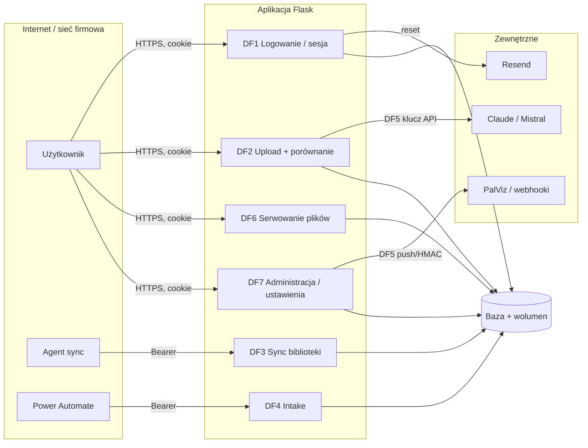

# Model zagrożeń (STRIDE) — wersja 0.1

> [SEC] Granice zaufania: (1) Internet ↔ aplikacja, (2) aplikacja ↔ baza/wolumen, (3) aplikacja ↔ API zewnętrzne,
> (4) sieć firmowa (agent, `Z:\`) ↔ aplikacja. Oceny: 🔴 krytyczne · 🟠 wysokie · 🟡 średnie · ⚪ niskie.
> Identyfikatory ryzyk R-xx → `RYZYKA.md`; historyjki US-xxx → `../analiza/HISTORYJKI.md`.

## Diagram przepływów

## STRIDE per przepływ

### DF1 — Logowanie, sesja, reset hasła
| Zagrożenie | Scenariusz | Istniejące zabezpieczenie | Luka / ocena | Działanie |
|---|---|---|---|---|
| Spoofing | brute-force hasła, credential stuffing | limit 5/15 min per IP (pamięć procesu), dummy-hash (brak enumeracji), min. 8 znaków | limit per worker, brak blokady konta, rotacja IP 🟠 | US-005 (SEC-001) |
| Spoofing | przejęcie konta przez token resetu z bazy/backupu | token losowy 32 B, jednorazowy, atomowe `UPDATE` | token jawny, 24 h 🟡 | US-003 (SEC-002) |
| Tampering | podmiana cookie sesji | podpis `SECRET_KEY`, fail-closed w prod | placeholder z `.env.example` akceptowany ⚪ | US-018 |
| Repudiation | brak śladu logowań | `audit_log` login/login_fail/logout z IP | — ✅ | — |
| Info disclosure | enumeracja kont przez czas odpowiedzi / komunikaty | dummy-hash, komunikat generyczny przy resecie | — ✅ | — |
| DoS | zalew `/forgot-password` → e-maile | limit 3/15 min per IP + 3 tokeny/15 min per konto | ✅ | — |
| Elevation | zmiana roli w sesji | rola czytana z DB przy logowaniu; `check_session_active` co żądanie | brak re-walidacji roli po zmianie w DB (do wylogowania) ⚪ | US-009 (odświeżanie roli) |

### DF2 — Upload i porównanie (w tym AI)
| Zagrożenie | Scenariusz | Zabezpieczenie | Luka | Działanie |
|---|---|---|---|---|
| Tampering | złośliwy PDF (bomba dekompresji, JS, 200 stron 220 DPI) | magic bytes, odrzucenie PDF z hasłem, limit 200 MB, 30/min, semafor 3, timeout 300 s | brak limitu stron/pikseli; nie wszystkie 39 miejsc `request.files` używają wspólnych walidatorów 🟡 | US-019, przegląd tras |
| Tampering | **prompt injection** w treści PDF → fałszywy werdykt AI | wynik AI doradczy; JSON parsowany | brak ramki „dane, nie instrukcje" 🟠 | US-007 (SEC-004) |
| Info disclosure | cudzy raport/strony przez `cache_id`/`cid` | kontrola właściciela (IDOR) + testy; `is_public` jawne | — ✅ | utrzymać test na każdy nowy endpoint (SEC-007) |
| Info disclosure | wyciek know-how do dostawcy AI | `use_ai` opcjonalne, 3000 znaków/plik | brak potwierdzonego DPA 🟡 | Z-04, RODO.md |
| DoS | wyczerpanie RAM/CPU przez wiele porównań | semafor, rate limit, `max_requests` gunicorn | 2 workery × modele ~2 GB ⚪ | monitoring, RQ (US-015) |
| Repudiation | kto uruchomił porównanie | `audit_log artwork_compare` + `comparisons.user_id` | ✅ | — |

### DF3 — Synchronizacja biblioteki (agent on-prem)
| Zagrożenie | Scenariusz | Zabezpieczenie | Luka | Działanie |
|---|---|---|---|---|
| Spoofing | fałszywy agent | Bearer token 64 hex, `compare_digest`, reset tokenu przez admina | token w DB jawnie (jak hasła? nie — token, ale wysoka entropia) ⚪ | rotacja w RUNBOOK |
| Tampering | path traversal w `rel_path` | `realpath` + prefiks `LIBRARY_FOLDER` | ✅ | test regresji (brak) |
| Tampering | podmiana mastera przez agenta | `is_master` tylko z agenta; potwierdzenie przez managera | ✅ | — |
| DoS | 31k żądań | brak limitu dla tokenu | ⚪ | limit per token (Could) |

### DF4 — Intake (Power Automate)
Spoofing: `INTAKE_TOKEN` z env, `compare_digest`, 503 gdy brak tokenu ✅. Tampering: magic bytes, `secure_filename`,
nazwa z hashem ✅. DoS: brak limitu wywołań ⚪ (Could). Repudiation: `sender/subject` logowane ✅.

### DF5 — Wyjścia: AI, PalViz, webhooki, e-mail
| Zagrożenie | Scenariusz | Zabezpieczenie | Luka | Działanie |
|---|---|---|---|---|
| SSRF | webhook na adres wewnętrzny | `_is_ssrf_blocked_url` (prywatne, loopback, link-local, tylko http/https) | DNS rebinding między sprawdzeniem a wysyłką ⚪ | akceptowane (R-12) |
| Info disclosure | klucz API w bazie / w `os.environ` z requestu | — | 🟡 | US-004 (SEC-003) |
| Spoofing | fałszywy odbiorca PalViz | `PALVIZ_PUSH_URL` tylko z env, Bearer, Idempotency-Key | ✅ | — |
| Tampering | zdarzenie webhooka sfałszowane po stronie odbiorcy | podpis HMAC-SHA256 | ✅ | — |

### DF6 — Serwowanie plików (mastery, GLB, miniatury, eksporty)
| Zagrożenie | Scenariusz | Zabezpieczenie | Luka | Działanie |
|---|---|---|---|---|
| Info disclosure | cudzy GLB | prefiks `uid_` + `can_see_all` | ✅ | — |
| Tampering | traversal w `<path:fname>` | `secure_filename`, `send_from_directory`, `safe_join` | ✅ | — |
| Tampering | **zapis w dowolnym katalogu** (`save-copy`) | `ARTWORK_COPY_ROOTS` (opcjonalne) | fail-open bez env 🟡 | US-006 (SEC-006) |
| Info disclosure | eksport HTML/DOCX z raportem | wymaga sesji właściciela | ✅ | — |

### DF7 — Administracja
| Zagrożenie | Scenariusz | Zabezpieczenie | Luka | Działanie |
|---|---|---|---|---|
| Elevation | `user` wywołuje endpoint admina | `require_role`, CSRF, testy 403 dla wybranych tras | brak testu „403 per rola" dla większości 297 tras ⚪ | SEC-007 w DoD |
| Tampering | CSRF na akcjach admina | `csrf_protect` + `SameSite=Strict` | `GET /logout` ⚪ | US-017 |
| Info disclosure | XSS w panelu (199 `innerHTML`) | Jinja autoescape, brak `\|safe` | CSP `unsafe-inline`/`unsafe-eval` 🟡 | US-008 (SEC-005) |
| Repudiation | zmiany kont bez śladu | brak funkcji → zmiany w DB ręcznie 🟡 | US-009 |

## Wymagania bezpieczeństwa wynikające z modelu (SEC-*)

SEC-001 limity logowania współdzielone + blokada konta · SEC-002 tokeny resetu hash, 1 h · SEC-003 sekrety tylko
z env · SEC-004 prompt: dane ≠ instrukcje + walidacja schematu · SEC-005 CSP bez `unsafe-eval`, nonce ·
SEC-006 operacje na ścieżkach fail-closed · SEC-007 test 403 dla każdej roli przy każdej nowej trasie ·
SEC-008 zależności z lockiem i skanem w CI · SEC-009 kontener non-root, `HEALTHCHECK` · SEC-010 limit stron/DPI
dla OCR.
